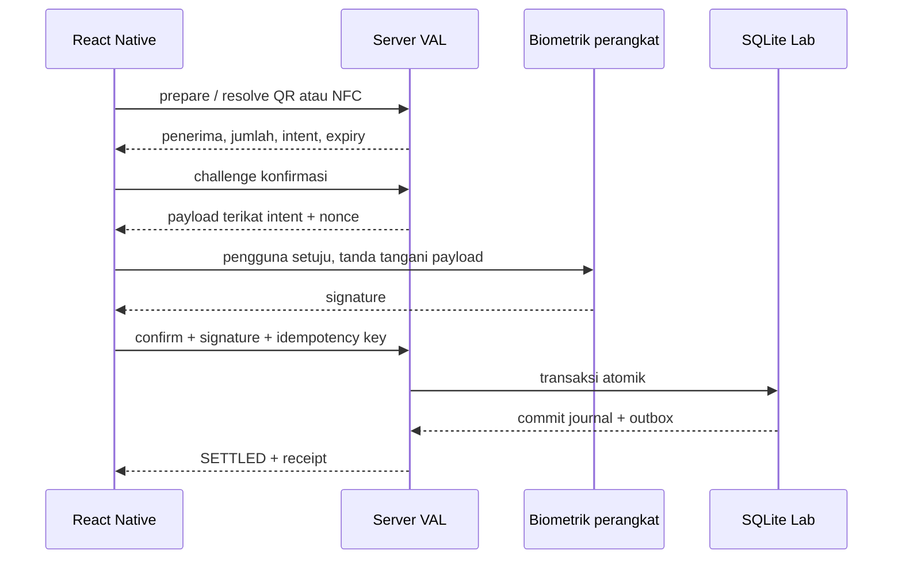

# Server mandiri dan VAL Lab

Implementasi 30 Oktober 2026 di `C:\Program Files X\waw-ev-wallet`. Tujuan tetap EV-wallet VAL mandiri untuk keluarga WAW; Arcade adalah integrasi eksternal. Tahap ini menambahkan server API untuk akun individual, transfer virtual, QR VAL Demo dan kontrak NFC/biometrik React Native sesuai persetujuan pengguna.

## Menjalankan dan menguji akun

```powershell
npm run server:init
npm run build
npm run server:lab
```

Buka `http://127.0.0.1:3212/lab`. Login awal memakai password dari `.local/test-accounts.json`, bukan password bersama/hard-coded. Akun `alice.test`, `bob.test`, `merchant.test`, dan `operator.test` masing-masing diberi 1.000 VAL Lab sekali pada inisialisasi pertama. Operator dapat membuat undangan USER/MERCHANT satu kali; pendaftar memilih password sendiri dan menerima delapan recovery code sekali pakai. File kredensial lokal juga menyimpan service credential merchant demo; jangan memasukkan service credential ke aplikasi mobile. DB persisten ada di `.local/val-lab.sqlite`, diabaikan `.gitignore` bersama file kredensial.

Untuk mencoba transfer: buka Alice dan Bob di tab berbeda, daftarkan kunci uji pada tab Alice, siapkan transfer ke `bob.test`, periksa penerima/nominal, konfirmasi, lalu segarkan saldo Bob. Untuk QR: buat permintaan di Bob, scan dari aplikasi native atau salin URI ke kolom baca di Alice, periksa preview dan konfirmasi. Browser hanya menggunakan kunci software dalam memori; bukan autentikasi sidik jari.

`VAL_LAB_DATABASE`, `VAL_PORT` (alias lama `VAL_MOBILE_PORT`), `VAL_MOBILE_HOST`, `VAL_PUBLIC_ORIGIN` mengatur server. Default port 3212 berasal dari `config/ports.json`, bind loopback. `npm start`, `npm run dev`, dan `npm run server:lab` adalah pilihan alternatif untuk server yang sama. Init ulang tidak mereset password/saldo, tidak mengisi ulang faucet. Backup SQLite harus memakai mekanisme backup SQLite/snapshot yang konsisten dengan WAL; jangan menyalin file utama saja saat writer berjalan. Restore/operasi produksi belum dijalankan.

## Batas ekonomi dan sumber saldo

| Server | Data | Tanggung jawab |
|---|---|---|
| `src/platform/server.mjs`, port 3212 | `.local/val-lab.sqlite`, pocket `lab` | Akun uji, API mobile, P2P, QR/NFC, integration request/outbox |
| `src/server.mjs`, default port 3213 | Fixture Arcade / ledger Arcade yang kompatibel | Integrasi permainan yang sudah ada; `npm run server:arcade` |
| `scripts/demo-arcade.mjs`, wallet port 3213 | Database fixture bersama sementara | Demo dua aplikasi wallet + Arcade; alternatif `server:arcade` |

Saldo Lab adalah ekonomi uji terpisah, bukan salinan saldo Arcade. API menolak pocket `arcade`/`world`, cookie Arcade, receiver bebas pada service integration, dan pembukaan database Arcade sebagai Lab. Tidak ada konversi rupiah, cash-out, top-up uang nyata, atau transfer antarpocket. `VAL_DATABASE` milik server Arcade tidak digunakan server Lab.

## Database SQLite lengkap untuk alur yang aktif

Definisi SQL: [mobile.schema.sql](../api/mobile.schema.sql). Sumber migrasi/inisialisasi: [db.mjs](../../src/platform/db.mjs), metadata schema versi 3. `npm run api:docs` mengekspor skema tanpa akun, password, token atau data transaksi.

| Tabel | Data / hubungan |
|---|---|
| `platform_meta` | Identitas `VAL_LAB`, versi skema |
| `users` | Handle unik, nama, role USER/MERCHANT/OPERATOR, hash scrypt + salt password, status dan lockout |
| `accounts` | Satu wallet per pengguna, faucet dan offset penerbitan; scope VAL/lab |
| `journals` | Referensi bisnis unik, jumlah, jenis, waktu dan urutan transaksi |
| `entries` | Dua delta bertanda per jurnal, FK ke akun; total nol |
| `sessions` | Hash access/refresh token, keluarga rotasi, kedaluwarsa, pencabutan |
| `session_context` | Label klien dan aktivitas terakhir untuk daftar sesi pengguna |
| `devices` | Public key RSA unik per perangkat, pemilik, label, pencabutan |
| `registration_invites` | Hash undangan satu kali, role yang ditentukan operator, expiry dan pengguna yang menebus |
| `recovery_codes` | Hash recovery code sekali pakai dan waktu konsumsi; kode asli tidak disimpan |
| `challenges` | Payload nonce sekali pakai untuk enroll/login/confirm; user/session/device/intent terikat |
| `intents` | Pembuat, pengirim/penerima, app, nominal, kanal, expiry, status dan jurnal settlement |
| `commands` | Actor + idempotency key, fingerprint request, hasil committed untuk retry |
| `integrations` | Service token hash, receiver tetap, scopes dan pencabutan |
| `outbox` | Event settlement atomik dengan scope app dan cursor polling |
| `refunds` | Relasi jurnal refund ke transaksi asal, initiator dan nominal untuk batas kumulatif |
| `notifications` | Pesan status privat per akun, cursor urut dan waktu dibaca |
| `audit` | Actor, aksi, referensi dan waktu; tanpa token/password |

Semua nominal API berupa string integer. Batas per transaksi 100.000.000.000 VAL, saldo dicek terhadap integer aman. `accounts.balance` diperbarui bersama journal/entries dalam commit yang sama dan direkonsiliasi terhadap semua entries. Semua opening balance nol; genesis memindahkan 1.000.000 VAL dari akun offset penerbitan ke faucet, kemudian grant awal berasal dari faucet. Hanya akun offset boleh negatif. Penerbitan tidak tersedia melalui API.

Konfirmasi berjalan dalam `BEGIN IMMEDIATE`: verifikasi session/proof → pemeriksaan saldo → journal + entries + saldo → intent settled → outbox/audit → hasil idempotensi → commit. Kegagalan salah satu langkah menggulung seluruh transaksi. SQLite memakai WAL, FK, `synchronous=FULL`, busy timeout. Tidak ada hold untuk pembayaran instan ini; `held` bernilai nol dan `available` sama dengan posted. Intent pending belum mencadangkan dana dan dapat ditolak jika saldo habis saat konfirmasi.



## Kontrak API dan integrasi aplikasi

Spesifikasi: [OpenAPI 3.1](../api/mobile.openapi.json), juga disajikan di `/openapi.json`. API pengguna berawalan `/api/mobile/v1`; SDK dan contoh native ada di [mobile/README.md](../../mobile/README.md).

| Alur | Endpoint utama |
|---|---|
| Password/session | `POST /auth/login`, `/auth/refresh`, `/auth/reauthenticate`, `/auth/logout` |
| Registrasi/recovery | `POST /auth/register`, `/auth/recover`, `/recovery-codes/rotate` |
| Profil/sesi | `GET /me`, `/sessions`; `POST /me/profile`, `/me/password`, `/sessions/logout-others`, `/sessions/logout-all`; `DELETE /sessions/:id` |
| Operator | `POST /admin/registration-invites` untuk role USER/MERCHANT |
| Perangkat | `POST /devices/challenge`, `/devices/enroll`; `GET /devices`; `DELETE /devices/:id` |
| Login biometrik | `POST /auth/biometric/challenge`, `/auth/biometric/verify` |
| Saldo/riwayat | `GET /wallet?before=...&limit=20`, `/transactions/:id`, `/me` |
| Transfer | `GET /recipients?handle=...`, `POST /transfers/prepare` |
| QR/NFC | `POST /payment-requests`, `/payment-requests/resolve`; `GET /intents/:id/code` |
| Konfirmasi/status | `POST /intents/:id/challenge`, `/confirm`, `/cancel`; `GET /intents/:id` |
| Refund | `POST /transactions/:id/refunds/challenge`, lalu `/refunds`; hanya penerima transaksi asli |
| Notifikasi | `GET /notifications`; `POST /notifications/:id/read`, `/notifications/read-all` |

Mutasi enroll/prepare/request/confirm/cancel memerlukan `Idempotency-Key` acak 12–100 karakter. Key yang sama dan body sama mengembalikan hasil tersimpan; body berbeda menghasilkan 409. Kehilangan respons setelah commit bukan kegagalan pembayaran: enquiry status atau ulangi body/key identik. Intent punya batas lima menit; challenge dua menit. Status `EXPIRED` diproyeksikan dari expiry pada intent pending. QR/NFC hanya referensi opaque, tidak menyimpan nominal/penerima tepercaya pada tag.

Refund juga memerlukan `Idempotency-Key` dan challenge signature yang mengikat transaksi asal, nominal, payer, perangkat dan scope VAL/lab. Hanya akun yang menerima entry positif pada transaksi `TRANSFER`/`PAYMENT` dapat mengembalikan dana. Setiap refund adalah jurnal `REFUND` baru; jumlah kumulatif tidak boleh melewati pembayaran awal dan saldo pemberi refund tetap tidak boleh negatif. Refund terhadap transaksi integration membuat event `payment.refunded` dalam commit yang sama.

Filter histori `kind` (`TRANSFER`, `PAYMENT`, `REFUND`, `INITIAL_CREDIT`) dan `direction` (`IN`, `OUT`) dijalankan server sebelum pagination. Receipt menampilkan lawan transaksi, jurnal asal refund, serta nominal sudah/masih dapat direfund. Notifikasi settlement, cancellation, dan refund hanya dapat dibaca pemilik akun.

Integrasi server eksternal memakai service credential terpisah, hanya di backend:

```http
POST /internal/val/v1/payment-requests
Authorization: Bearer <service-token-dari-file-lokal>
Idempotency-Key: <uuid-bisnis-stabil>
Content-Type: application/json

{"amount":"25","channel":"QR_VAL_DEMO","currency":"VAL","pocket":"lab"}
```

Receiver ditentukan dari `integrations.receiver_id` (merchant demo: `merchant.test`). Aplikasi konsumen menampilkan payload QR/NFC dari respons dan membaca `GET /internal/val/v1/events?after=0` memakai credential yang sama. Endpoint event hanya mengembalikan event milik aplikasi tersebut; respons memberikan `next_cursor`. Consumer harus menyimpan cursor **setelah** pemrosesan berhasil dan deduplikasi `event.id` agar pengulangan polling tidak menggandakan pesanan. Event tidak dapat memerintahkan debit baru.

Ini request + polling outbox yang berfungsi, belum webhook/retry delivery otomatis, service provisioning UI, settlement lintas ekonomi atau remote game engine. Integrasi permainan Arcade tetap memakai ledger bersama yang sudah ada agar state game dan settlement tetap atomik.

## Autentikasi dan kesiapan

Access token opaque 15 menit, refresh token 30 hari dan berotasi; reuse token lama mencabut keluarga sesi. Token disimpan sebagai hash di DB. Lima password salah mengunci login password selama 15 menit; rate limit lokal memproteksi HTTP. Enrollment memerlukan password baru, proof kepemilikan kunci, lalu public key dinormalisasi. Raw biometrik tidak dikirim. Konfirmasi memverifikasi nonce, user, keluarga sesi, perangkat aktif, intent, nominal, receiver dan pocket; pemeriksaan otorisasi bukan boolean dari klien.

QR ini bernama **QR VAL Demo**, bukan QRIS. [Bank Indonesia menjelaskan QRIS sebagai standar pembayaran melalui penyelenggara berizin](https://www.bi.go.id/id/fungsi-utama/sistem-pembayaran/ritel/kanal-layanan/qris/default.aspx). QRIS uang nyata memerlukan integrasi provider dan proyek pembayaran terpisah; pada tahap yang disetujui, capability QRIS/EMV nonaktif dan payload QRIS ditolak.

Belum siap produksi: aplikasi native lengkap/build perangkat, verifikasi sensor/tag fisik, hardware attestation, recovery/reset password, session management seluruh perangkat, provision/rotasi credential operator, observability dan rate limit terdistribusi, retensi data/expiry cleanup, backup/restore dan audit independen belum selesai. HTTPS dapat disediakan reverse proxy; host publik tidak diterbitkan dalam pengerjaan ini. Tidak ada klaim pengujian QRIS bank atau sidik jari/NFC fisik.
